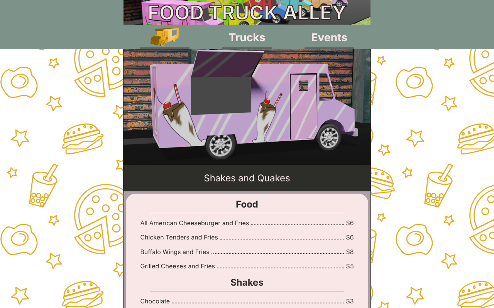

# Food Truck Alley

A website for a food truck park, built by **Daniel Painter** and **Glenn Freeman** for the 2023 FBLA Collegiate Website Design event.

| Competition | Date | Result |
| --- | --- | --- |
| FBLA Collegiate State Leadership Conference | April 2023 | 2nd place |
| FBLA Collegiate National Leadership Conference | June 2023 | 7th place |

<!-- After turning on GitHub Pages for this fork, uncomment the next line:
**Live site:** https://anotherdandev.github.io/FBLA_Collegiate_Website_Design_2023/
-->

## What's on the site

Visitors can browse the trucks at the park, read each truck's menu, place an order, and see which events are coming up. The trucks, menus and events were made up for the competition.

| Page | What it shows |
| --- | --- |
| Home (`index.html`) | A map to the park, the next event, and a few featured trucks |
| Trucks (`trucks.html`) | A grid of all 12 trucks |
| Truck pages (`trucks/`) | One page per truck with its picture, menu and prices, an order form, and an "About Us" section |
| Events (`events.html`) | The six scheduled events with dates, times and descriptions |
| Event pages (`events/`) | One page per event with a map, a description, and the trucks taking part |
| Copyrights (`copyrights.html`) | License and attribution |

## How it's built

- **Plain HTML and CSS.** No frameworks, libraries or build step. One stylesheet, `styles.css`, styles every page.
- **Truck artwork.** Each truck has its own painted design. The Photoshop source files are in `TruckTextures/`, and the pictures used on the site are in `resources/`.
- **Ordering.** Each truck page embeds a Google Form, so orders could be collected without a server.
- **Maps.** The home page and event pages embed a Google Map of the park's location.

## Running it

Download or clone the repository and open `index.html` in a browser. Nothing needs installing.

The maps and order forms are loaded from Google, so they need an internet connection. The order forms date from the 2023 competition and may no longer accept responses.

## Repository layout

| Path | Contents |
| --- | --- |
| `index.html`, `trucks.html`, `events.html` | The three main pages |
| `trucks/` | The 12 individual truck pages |
| `events/` | The six individual event pages |
| `styles.css` | The stylesheet shared by every page |
| `resources/` | Truck pictures, event icons, the banner, the logo and the background pattern |
| `TruckTextures/` | Photoshop source files for the truck designs |
| `template t1.html`, `template t2.html` | Blank page templates used while building the site |
| `orders.html`, `locations.html` | Earlier standalone pages that are no longer linked from the navigation |

## About this fork

This is Daniel Painter's fork of the original team repository, [GlennFreeman/FBLA_Collegiate_Website_Design_2023](https://github.com/GlennFreeman/FBLA_Collegiate_Website_Design_2023). The code and commit history are unchanged from the competition entry; this README was added afterwards.

Daniel's commits in the history appear under his earlier GitHub account, **Saratoubi**. Glenn's appear under **GlennFreeman**.

## Credits

- **Daniel Painter** ([AnotherDanDev](https://github.com/AnotherDanDev)) and **Glenn Freeman** ([GlennFreeman](https://github.com/GlennFreeman)): design, development and content
- Built for the Future Business Leaders of America (FBLA) Collegiate Website Design event, 2023

## License

Released under [CC0 1.0 Universal](LICENSE).
